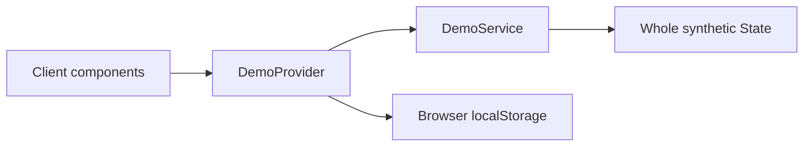

# Current system and migration constraints

Inspected 17 November 2026. This document preserves the browser-local demo baseline used to design the backend migration. The connected identity/private-support slice has since been implemented and committed in `2069764`; its current setup and remaining gates are in [development](development.md) and [staging](staging.md).

## Overview

BeeTip is a Next.js mobile web demo with a synchronous, browser-local application service. `apps/web/src/app/layout.tsx` wraps the entire application in `DemoProvider`. The provider creates synthetic state, selects a fictional actor, and persists the full dataset under `beetip-demo-v2`.

## Key concepts

`packages/domain/src/index.ts` defines `ApplicationService`, `Command`, `State`, and `DemoService`. One member can request or fulfill an order. Accepted terms are copied into the order. Funding, fulfillment, transfers, and disputes have separate states. `totals()` derives reconciliation amounts. `packages/validation/src/index.ts` validates forms and stored demo records.

## How it works

Components synchronously call queries or submit a `Command` through `run()`. `execute()` checks the selected persona, snapshots state for rollback, expires reservations, applies a command, and appends operation and audit records. Confirmation failures deliberately retain attempt counters and rejection audit. A successful local mutation replaces React state and browser storage.

Acceptance checks customer count, spending capacity, schedule consent, and expiry before creating a 15-minute reservation. Verified incoming funds gate purchasing. Amendments require customer approval and additional verified funds when needed. Shared receipt allocations prevent duplicate reimbursement in the local dataset. Delivery confirmation enables payout eligibility. Refunds and exceptional payouts require another demo administrator.

Order chat appends local message records after participant checks. Support threads belong to their member and can optionally reference an order. Administrators reply and resolve threads. Neither conversation synchronizes between devices. Unverified members can seek support but cannot transact.

## Where things live

| Existing location | Responsibility |
| --- | --- |
| `apps/web/src/components/demo-provider.tsx` | Persona selection, storage, state updates, browser expiry timer |
| `apps/web/src/components/orders.tsx` | Order detail and order chat interactions |
| `apps/web/src/components/support.tsx` | Member support, support inbox, listing moderation |
| `packages/domain/src/index.ts` | Lifecycle rules, calculation, synthetic service, and fixtures |
| `packages/domain/src/domain.test.ts`, `ux.test.ts` | Sequential domain behavior and migration examples |
| `tests/demo.spec.ts`, `tests/ux.spec.ts` | Demo browser journeys |
| `.github/workflows/ci.yml` | Lint, types, unit tests, production-build browser tests |

## Gotchas

The demo browser can inspect and change every synthetic record and actor. Its checks demonstrate rules without establishing a trusted authorization boundary. The connected identity slice now supplies migrations and trusted sessions independently of this demo. Private uploads, deployed jobs, and verified live email delivery remain unfinished.

The current interface returns immediate values. Real server operations require promises, pagination, loading states, and recoverable failures. Replace callers by feature rather than pretending a network adapter can satisfy synchronous signatures.

Demo idempotency does not hash the complete payload. Production must scope keys to authenticated actors, reject changed payloads, and commit the result with the mutation. Browser capacity checks do not establish database concurrency safety. Database time must govern expiry even when cleanup is late.

Production must replace plaintext confirmation codes, shallow immutable terms, concatenated receipt keys, and local role flags with server and database enforcement. The demo's fixed cancellation refund formula and whole-order dispute flag do not satisfy evidence-based partial resolutions. Support messages need stable IDs, ordering, pagination, and read cursors.

Keep synthetic storage isolated. Production must never import demo personas, payment records, or delivery codes. Preserve legacy demo accepted terms when maintaining its version migration.

## Rationale evidence and constraints

`docs/PRD.md` sections 4, 8, 11, and 17 establish responsive web, supervised payments, separate money and fulfillment, and operating decisions. Git history records the foundation in `b60f59d`, the local marketplace in `da57d28`, and support and moderation in `6d96dd8`. The code and README explicitly identify a demo integration boundary. The inferred purpose of local persistence is to exercise workflows without external accounts. No private team deliberation or live operating telemetry was used to establish that inference.

Preserve Indonesian mobile UX, integer IDR, immutable commitments, two-way participation, and independent transfer review. Change identity, persistence, atomicity, messaging delivery, and expiry ownership. Avoid carrying demo flags, whole-state downloads, and simulated settlement into the connected pilot. Treat partial financial resolution and authorization as integration risks, not completed capabilities.
