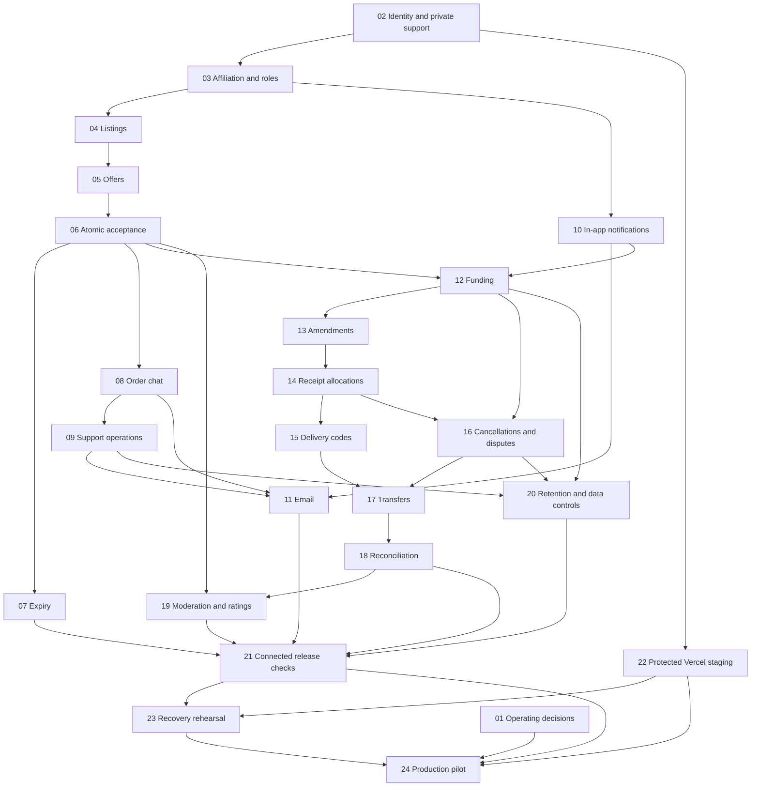

# Implementation plan and issue index

Planned on 17 November 2026. The [roadmap issue](https://github.com/BeeTip/beetip/issues/2) tracks 24 implementation and owner-decision issues. Every issue has a user outcome, acceptance criteria, blocking references, and closure evidence requirements. No implementation, paid provisioning, or deployment is included in this documentation pass.

## Delivery contract

The owner's 18 November [public onboarding policy](public-onboarding.md) supersedes mandatory campus membership approval and the closed staging cohort. Public sample browsing and email-confirmed self-service accounts are the current slice; affiliation review must become optional, and real marketplace transactions remain in later issues.

[BTP-02](https://github.com/BeeTip/beetip/issues/4) and [BTP-22](https://github.com/BeeTip/beetip/issues/24) passed identity-slice acceptance on 18 November 2026. [Development evidence](development.md) and [protected staging acceptance](staging.md) record real email confirmation/recovery, verified operator MFA and assignment, recipient restrictions, deployment protection, failures and cleanup. Staging uses the owner's personal Hobby account and Brevo Free under a zero-cost limit. Later marketplace and release work remains open.

Implement against the [system design](system-design.md), [messaging contracts](messaging.md), and [deployment runbook](vercel-deployment.md). [Current-system grounding](current-system.md) distinguishes demo behavior from real backend requirements. Candidate alternatives and review findings are retained in [design review](design-review.md).

The machine-readable work breakdown is [implementation-issues.json](implementation-issues.json). [issue-links.json](issue-links.json) maps its stable keys to published issues. Keep the source catalog and tracker contract reconciled whenever scope changes. The order below is dependency order, not a promised schedule. Owners and estimates are assigned after team availability is known.

## Release stages

1. Establish the first connected path with real test identity and private support in BTP-02. BTP-01 records operating decisions concurrently. BTP-22 establishes protected staging early.
2. Add optional affiliation and scoped staff access, then extend active confirmed accounts through listings, offers, atomic acceptance and database-driven expiry in BTP-03 through BTP-07.
3. Add durable order/support conversation recovery, inbox notifications and transactional email in BTP-08 through BTP-11. BTP-10 can begin after identity and staff scopes exist.
4. Extend verified funding through amendments, shared receipts, secure handover, partial resolution, transfers and reconciliation in BTP-12 through BTP-18.
5. Complete moderation, ratings, retention and account data controls in BTP-19 and BTP-20.
6. Validate the exact connected candidate in BTP-21, rehearse recovery in BTP-23, and promote the capped pilot in BTP-24 after owner and financial gates pass.

Each feature slice includes its schema, policies, command, authorized projections, UI, tests, event mapping, and evidence. The baseline database harness in BTP-02 expands with each slice rather than becoming a separate unfinished backend phase.

BTP-06 and BTP-10 passed integrated local and dedicated-development acceptance on 18 November 2026 at code candidate `64a865e`. BTP-07 expiry and BTP-08 durable order chat passed integrated local and dedicated-development acceptance at `3be74a8`. [Atomic acceptance](connected-orders.md) · [Notifications](notifications.md) · [Expiry and chat acceptance](expiry-chat-acceptance.md).

BTP-09 support operations and BTP-12 synthetic incoming funding passed local acceptance on the combined Supabase schema. Staging deployment and production release gates remain open. [Support acceptance](connected-support.md) · [Funding acceptance](connected-funding.md).

## Issue index

| Key | Published issue | Blocked by | Work type |
| --- | --- | --- | --- |
| BTP-01 | [#3 Approve pilot operations, account ownership, and release policies](https://github.com/BeeTip/beetip/issues/3) | None | Owner decision |
| BTP-02 | [#4 Connect real sign-in and pending-member private support](https://github.com/BeeTip/beetip/issues/4) | None | Complete |
| BTP-03 | [#5 Review affiliation and grant scoped staff access](https://github.com/BeeTip/beetip/issues/5) | [#4](https://github.com/BeeTip/beetip/issues/4) | Complete locally and development DB; web deployment pending |
| BTP-04 | [#6 Publish and browse both real listing types](https://github.com/BeeTip/beetip/issues/6) | [#5](https://github.com/BeeTip/beetip/issues/5) | Complete locally and development DB; web deployment pending |
| BTP-05 | [#7 Negotiate offers with versioned consent](https://github.com/BeeTip/beetip/issues/7) | [#6](https://github.com/BeeTip/beetip/issues/6) | Complete locally and development DB; web deployment pending |
| BTP-06 | [#8 Accept offers atomically and reserve trip capacity](https://github.com/BeeTip/beetip/issues/8) | [#7](https://github.com/BeeTip/beetip/issues/7) | Complete locally and development DB; web deployment pending |
| BTP-07 | [#9 Expire unpaid reservations without losing verified funding](https://github.com/BeeTip/beetip/issues/9) | [#8](https://github.com/BeeTip/beetip/issues/8) | Complete locally and development DB; web deployment pending |
| BTP-08 | [#10 Deliver private order chat with durable retry and catch-up](https://github.com/BeeTip/beetip/issues/10) | [#8](https://github.com/BeeTip/beetip/issues/8) | Complete locally and development DB; web deployment pending |
| BTP-09 | [#11 Operate private support assignment and escalation](https://github.com/BeeTip/beetip/issues/11) | [#10](https://github.com/BeeTip/beetip/issues/10) | Local acceptance complete |
| BTP-10 | [#12 Deliver reliable in-app event notifications](https://github.com/BeeTip/beetip/issues/12) | [#5](https://github.com/BeeTip/beetip/issues/5) | Complete locally and development DB; web deployment pending |
| BTP-11 | [#13 Send recoverable transactional email and verify Auth delivery](https://github.com/BeeTip/beetip/issues/13) | [#10](https://github.com/BeeTip/beetip/issues/10), [#11](https://github.com/BeeTip/beetip/issues/11), [#12](https://github.com/BeeTip/beetip/issues/12) | Implementation |
| BTP-12 | [#14 Submit and verify manual incoming funding](https://github.com/BeeTip/beetip/issues/14) | [#8](https://github.com/BeeTip/beetip/issues/8), [#12](https://github.com/BeeTip/beetip/issues/12) | Local synthetic acceptance complete |
| BTP-13 | [#15 Approve substitutions and extra purchase budgets](https://github.com/BeeTip/beetip/issues/15) | [#14](https://github.com/BeeTip/beetip/issues/14) | Local connected acceptance complete with synthetic funding |
| BTP-14 | [#16 Allocate shared receipts across trip orders](https://github.com/BeeTip/beetip/issues/16) | [#15](https://github.com/BeeTip/beetip/issues/15) | Implementation |
| BTP-15 | [#17 Confirm delivery using secure expiring codes](https://github.com/BeeTip/beetip/issues/17) | [#16](https://github.com/BeeTip/beetip/issues/16) | Implementation |
| BTP-16 | [#18 Resolve cancellations and amount-specific disputes](https://github.com/BeeTip/beetip/issues/18) | [#14](https://github.com/BeeTip/beetip/issues/14), [#16](https://github.com/BeeTip/beetip/issues/16) | Implementation |
| BTP-17 | [#19 Review manual payouts and refunds with ambiguous recovery](https://github.com/BeeTip/beetip/issues/19) | [#17](https://github.com/BeeTip/beetip/issues/17), [#18](https://github.com/BeeTip/beetip/issues/18) | Implementation |
| BTP-18 | [#20 Reconcile each order and export the financial ledger](https://github.com/BeeTip/beetip/issues/20) | [#19](https://github.com/BeeTip/beetip/issues/19) | Implementation |
| BTP-19 | [#21 Moderate listings and collect ratings after completion](https://github.com/BeeTip/beetip/issues/21) | [#8](https://github.com/BeeTip/beetip/issues/8), [#20](https://github.com/BeeTip/beetip/issues/20) | Implementation |
| BTP-20 | [#22 Enforce private evidence retention and account data controls](https://github.com/BeeTip/beetip/issues/22) | [#11](https://github.com/BeeTip/beetip/issues/11), [#14](https://github.com/BeeTip/beetip/issues/14), [#18](https://github.com/BeeTip/beetip/issues/18) | Implementation |
| BTP-21 | [#23 Rehearse connected journeys and enforce release checks](https://github.com/BeeTip/beetip/issues/23) | [#9](https://github.com/BeeTip/beetip/issues/9), [#13](https://github.com/BeeTip/beetip/issues/13), [#20](https://github.com/BeeTip/beetip/issues/20), [#21](https://github.com/BeeTip/beetip/issues/21), [#22](https://github.com/BeeTip/beetip/issues/22) | Implementation |
| BTP-22 | [#24 Deploy the isolated Vercel staging candidate](https://github.com/BeeTip/beetip/issues/24) | [#4](https://github.com/BeeTip/beetip/issues/4) | Complete |
| BTP-23 | [#25 Rehearse backups, incidents, and compatible rollback](https://github.com/BeeTip/beetip/issues/25) | [#23](https://github.com/BeeTip/beetip/issues/23), [#24](https://github.com/BeeTip/beetip/issues/24) | Implementation |
| BTP-24 | [#26 Promote production and open the capped manual-payment pilot](https://github.com/BeeTip/beetip/issues/26) | [#3](https://github.com/BeeTip/beetip/issues/3), [#23](https://github.com/BeeTip/beetip/issues/23), [#24](https://github.com/BeeTip/beetip/issues/24), [#25](https://github.com/BeeTip/beetip/issues/25) | Owner release |

## Dependency routes

## Completion evidence

Before closing an issue, link its exact commit and appropriate test or artifact evidence. Demonstrate permission failures with separate real sessions. Record SQL concurrency outcomes for shared invariants. A passing local synthetic test does not prove RLS, external mail, bank settlement, or physical device behavior.

Update the selected design's implementation reconciliation section when an accepted change alters an outcome, signature, or ownership. Keep unresolved contract changes visible. Do not silently change the specification to match a shortcut. Use one owner per implementation issue and one independent reviewer for financial and authorization changes.

For new improvements, create a linked follow-up with the failing user scenario, current contract, expected result, acceptance test, and dependencies. Do not expand an active issue into unrelated work. Reconcile event mappings and retention effects when adding a new feature.

## Unresolved launch decisions

BTP-01 owns actual affiliation evidence, service area, operating hours, support escalation, retention, financial operators, collection/payout suitability, infrastructure budget and recovery objectives. BTP-24 remains blocked on those decisions even if the software is complete. Development and staging use synthetic money until the real-funds gate passes. The owner authorized the dedicated development Supabase project, personal Hobby staging and free email setup documented in [staging](staging.md); no paid service or custom domain was purchased.

