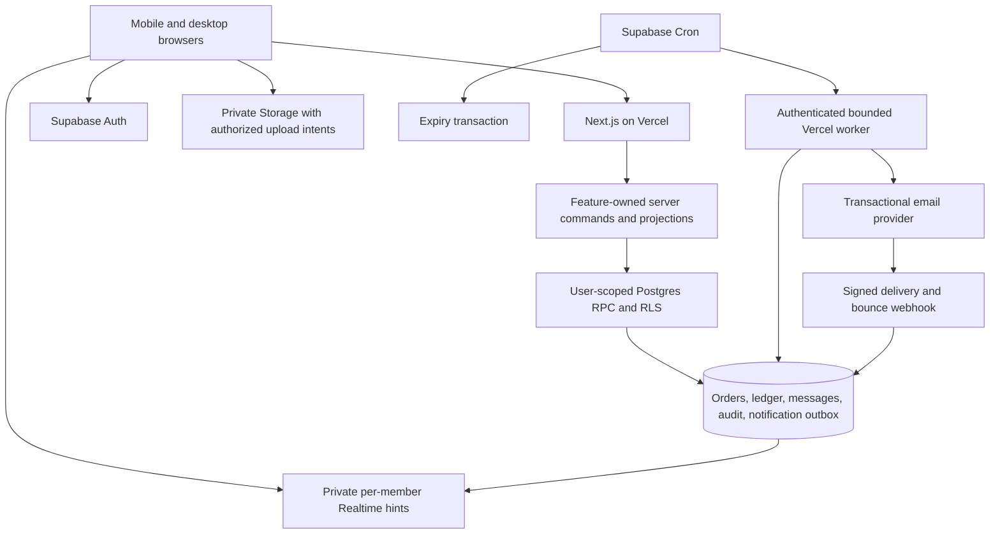
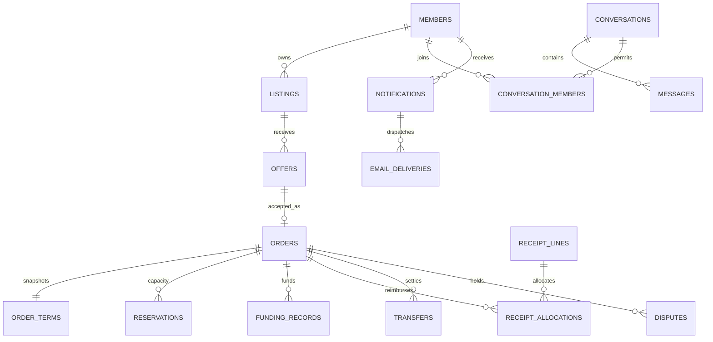

# Connected pilot system design

Current access policy, 18 November 2026: [public sample browsing and open onboarding](public-onboarding.md) supersede mandatory campus approval and the closed staging cohort. Confirmed email enables normal account access; staff roles, MFA, private-data isolation and suspension remain separate authorization rules.

Proposed design, 17 November 2026. Product scope was confirmed in this planning session. Implementation and deployment have not started. This document supersedes the connected-backend proposal in [the October architecture](architecture.md), which remains historical context.

## Problem

BeeTip needs real accounts, private order and support messaging, in-app and email notifications, and supervised manual payment operations. The current interface depends on synchronous browser state and synthetic personas. A connected pilot needs trusted identity, atomic shared-state changes, private projections, and recoverable background delivery without a separate backend deployment.

The [current-system explanation](current-system.md) establishes the migration constraints. The [PRD](PRD.md) remains the product contract. Preserve mobile web, Indonesian copy, integer IDR, two-way listings, immutable commitments, funding gates, and independent review. Structured actions govern financial and fulfillment state even when participants discuss those actions in chat.

## Usage, caller's view

Each UI action submits one typed command. Server routes derive identity from the session and return authorized projections. The following is a contract sketch, not runnable implementation.

```ts
const acceptance = await orders.acceptOffer({ offerId, operationId });
if (acceptance.ok) router.push(`/orders/${acceptance.value.orderId}`);
else showFailure(acceptance.error);

const sent = await messaging.send({ conversationId, clientMessageId, body });
if (sent.ok) mergeMessage(sent.value);
else retainFailedDraft(clientMessageId, sent.error);

const review = await ledger.reviewTransfer({ transferId, operationId });
if (review.ok) refreshTransfer(review.value.transferId);
else showFailure(review.error);
```

A timeout is not a business rejection. Retrying the same intended command retains its operation ID and exact payload. A changed payload requires a new ID. Never generate a new ID merely because the network response was lost.

## Shape

Choose a Next.js modular monolith on Vercel, with Supabase Auth, PostgreSQL, private Storage, and Realtime. Next.js is the sole application transport for protected reads and commands. Browser SDK access is limited to Auth, authorized upload intents, and private realtime subscriptions. PostgreSQL transaction functions own shared invariants. Supabase Cron triggers expiry and notification delivery work. A transactional email provider supplies Auth and application mail. Staging uses Brevo Free: initial custom SMTP was validated, then a signed Auth email hook added exact recipient restrictions through Brevo's HTTPS API. Application notification delivery remains later work.



The public interface hides locking, idempotency, role checks, redaction, and notification intent. Callers do not coordinate validate, reserve, create, and notify steps. Keep the route, feature operation, and transaction command traceable without a generic repository or event-bus layer. This follows boundary discipline and favors a small interface with substantial behavior.

### Core contracts

```ts
type Id<Kind extends string> = string & { readonly __kind: Kind };
type OperationId = Id<"operation">;
type OrderId = Id<"order">;
type OfferId = Id<"offer">;
type ConversationId = Id<"conversation">;
type MessageId = Id<"message">;
type TransferId = Id<"transfer">;
type Sequence = string & { readonly __kind: "decimal-sequence" };
type FailureCode = "VALIDATION" | "PERMISSION" | "CONFLICT" | "EXPIRED"
	| "INVALID_STATE" | "UNAUTHENTICATED" | "RATE_LIMITED" | "UNAVAILABLE";
type Outcome<T> = { ok: true; value: T; replayed: boolean }
	| { ok: false; error: { code: FailureCode; message: string; retryAfterSeconds?: number } };
type Message = {
	id: MessageId; conversationId: ConversationId; sequence: Sequence;
	senderId: string; body: string; createdAt: string;
};
type MessageWindow =
	| { mode: "latest" }
	| { mode: "older"; before: Sequence }
	| { mode: "catchUp"; after: Sequence };
type MessagePage = { items: Message[]; highWatermark: Sequence; hasMore: boolean };
interface Orders {
	acceptOffer(input: { offerId: OfferId; operationId: OperationId }): Promise<Outcome<{ orderId: OrderId }>>;
}
interface Messaging {
	send(input: { conversationId: ConversationId; clientMessageId: OperationId; body: string }): Promise<Outcome<Message>>;
	history(input: { conversationId: ConversationId; window: MessageWindow; limit: number }): Promise<Outcome<MessagePage>>;
	markRead(input: { conversationId: ConversationId; through: Sequence }): Promise<Outcome<{ through: Sequence }>>;
}
interface Ledger {
	reviewTransfer(input: { transferId: TransferId; operationId: OperationId }): Promise<Outcome<{ transferId: TransferId }>>;
}
async function acceptOffer(input: Parameters<Orders["acceptOffer"]>[0]): ReturnType<Orders["acceptOffer"]> {
	throw new Error("not implemented");
}
```

Parse branded IDs and decimal sequences behind boundary schemas. The browser never supplies an actor or trusted role. Business refusals and authentication failures return typed outcomes. The transport maps these to appropriate HTTP status codes. Unexpected failures return `UNAVAILABLE` with a correlation ID and sanitized logs. Preserve the five existing domain failure meanings when migrating callers. Use a separate authorized operation-status query to resolve a lost response without repeating an external side effect.

### Module ownership

| Proposed location | Owns |
| --- | --- |
| `apps/web/src/server/identity` | Request-scoped session validation, current affiliation and staff roles |
| `apps/web/src/server/marketplace` | Board projections, listings, offers, moderation |
| `apps/web/src/server/orders` | Acceptance, capacity, terms, amendments, fulfillment, confirmation |
| `apps/web/src/server/ledger` | Funding, receipts, allocations, cancellations, disputes, transfers, reconciliation |
| `apps/web/src/server/messaging` | Both conversation kinds, messages, membership, read cursors, case assignment |
| `apps/web/src/server/notifications` | Inbox, preferences, leased outbox, delivery outcomes |
| `apps/web/src/server/files` | Upload intents, validation, finalization, authorized download |
| `apps/web/src/app/api` | Thin transport adapters and protected job/webhook routes |
| `packages/domain` | Pure transition decisions, money calculations, value types |
| `packages/validation` | Input and result contracts, canonical command hashing rules |
| `packages/database` | Generated SQL types and server-only access, explicit exports |
| `supabase/migrations` | Schema, RLS, grants, invariant-owning commands, scheduler definitions |

Enforce server-only imports and package exports in the build. Client modules import domain contracts without database clients or credentials. One owner writes each state. Support reuses messaging rather than introducing another message store. SQL owns concurrent persistence invariants. Shared TypeScript rules provide previews and test fixtures, while parity tests catch SQL and TypeScript disagreement.

### Data model and access paths



Use UUIDs, UTC `timestamptz`, and WIB formatting. Store IDR as nonnegative PostgreSQL `bigint` bounded to JavaScript safe integers, validating aggregate calculations too. Keep financial references scoped to the actual bank account/provider namespace. Unique keys must not confuse references from different transfer systems.

Members reference Auth users. Verification requests and protected evidence are separate from public profiles. Staff role grants distinguish membership review, support, financial operation, financial review, and platform administration. Bootstrap the first operator through an audited owner procedure, with MFA and no client role-edit capability.

Listings have structured item rows, kind, owner, area, schedule, fee mode, limits, and moderation state. Offers have terms revision and author. Orders hold customer/provider, listing/trip relation, current version, fulfillment, and independent financial projections. Store accepted terms as insert-only snapshots and amendments as versioned consent records. Reservations contain capacity and expiry, but never use a browser clock as authority.

Normalize receipts into receipt headers, lines, discounts, and order allocations. Lock receipt lines before allocation and prevent allocated totals exceeding their approved value. One receipt can cover several orders without reimbursing the same value twice. Financial events, reviews, dispute holds, and audit are append-only facts. Audited compensating records correct mistakes. Payment evidence is not verified incoming money.

[Connected purchase progress](connected-purchases.md) implements private receipts and allocations on the payable-order lock. The provider can reuse remaining lines across a trip. Customers see per-order gross, discount and net, while the provider retains access to the shared original. Recorded purchases pin the affected approved item rows during subsequent amendments.

[Connected handover](connected-handover.md) lets the assigned provider start delivery after a full or partial purchase with goods to hand over. The customer inspects the goods and generates a 60-second code. The provider scans the QR or enters the backup code to confirm receipt. Confirmation records fulfillment in the synthetic pilot.

Index board filters by active state, kind, cutoff, and ID. Index participant orders separately by customer and provider with created time and ID. Index active reservations by listing/trip and expiry, offers by listing and author, receipts by normalized external reference, and transfers by order and status. Use keyset pagination. Messaging and outbox indices are specified in [messaging contracts](messaging.md).

### Atomic commands and single ownership

Every business mutation resolves the session server-side and calls a narrowly granted user-scoped RPC. Use the authenticated user's token, not a service key, for normal commands. Elevated SQL functions derive the user from `auth.uid()`, check current roles and membership themselves, use a fixed safe search path, and revoke broad execute privileges. A browser calling an exposed RPC directly must face the same invariant checks. Revoke direct table mutations for protected records.

An operation receipt is unique by authenticated actor and operation ID. It records command name, canonical full-payload hash, result, target, and timestamp. Same key and payload replays the committed result. Changed payload returns `CONFLICT`. Mutation, operation result, audit, and notification intents commit together. Serialize conflicting operations through the unique receipt key and row locks. Never expire financial receipts while their retry or audit obligations remain active.

Acceptance locks the listing and trip in a documented stable order, then checks current membership, ownership, schedule revision consent, cutoff, moderation, capacity count, total reserved spending, and offer terms using database time. It creates one order, immutable terms, reservation, conversation, and notification intents. Fixed requests use the same invariant owner. Amendment approval and expiry lock the same capacity owner. Background expiry cannot override newly verified funding. Concurrent verification and expiry resolve under the order lock with explicit deadline rules.

Funding verification records checked bank evidence and operator identity. Purchasing requires sufficient verified funds. Amendment approval reserves additional capacity and does not enable spending until additional funds are verified. Delivery codes are random, hashed server-side, valid for 60 seconds, bound to the order/customer/provider, and consumed atomically. Five failed attempts require regeneration. Failed attempt counters and sanitized audit commit even when the public outcome is a refusal.

[Connected amendments](connected-amendments.md) retain the original accepted snapshot, record each proposal against the current approved terms version, and replace the reserved budget at approval. Pending proposals block purchase eligibility. Synthetic funding records remain independent, with an exact outstanding-balance top-up and a purchase check against cumulative verified funds.

[BTP-12](connected-funding.md) implements the first funding command for explicitly assigned synthetic collection accounts. One verified bank entry must match the immutable order budget plus fee. The funding record, expiry marker, operation receipt, audit and notification intents share a transaction.

Transfers lock the order's unsettled allocation and transfer request. Refunds, disputed payouts, and post-purchase cancellation payouts require a different authorized reviewer. Freeze only the disputed unsettled amount. Preserve unrelated trip orders. Resolve cancellations and disputes with evidence-backed item, fee, refund, and hold allocations that balance to verified funds. Ambiguous bank transfers remain unresolved until account records establish the outcome. Software retries never initiate another bank transfer.

### Security and privacy boundaries

All protected server responses use private, no-store caching. Do not statically generate private order or admin pages. Validate same-origin mutation requests, safe redirect targets, body size, session freshness, current roles, and membership. RLS covers all exposed data and Storage metadata. Views use invoker-safe behavior and approved columns. Server credentials do not replace actor authorization.

Public listing projections omit full addresses, competitor offers, contact details, evidence, and confirmation material. Accepted counterparties receive the minimum handover information. Support access is assigned and audited. Financial access does not imply support-history access. Notification targets and signed URLs undergo the same current-permission checks as their records. Redact sensitive payloads from logs and analytics.

Auth SMTP, signup abuse protection, recovery, role revocation, account suspension, evidence retention, and upload restrictions are release requirements. [Messaging contracts](messaging.md) define read/sending behavior, reconnect, privacy-preserving hints, durable sequencing, rate limits, and email crash recovery.

### Migration from the demo

Do not preserve a synchronous `ApplicationService` contract over network I/O. Introduce async feature contracts and authorized read models. Remove direct `state.members`, `state.orders`, and whole-state reads from each connected caller. Provide pending, conflict, permission, empty, and retry states as that feature moves.

Keep demo fixtures and persona tools isolated under test/demo-only entry points. Connected production routes must fail closed if configuration is missing. They must never silently fall back to synthetic state. Do not import localStorage data into real records. Preserve current dirty UI changes and evaluate them separately when implementing their feature.

The first integration slice signs in a real test member and opens its private support thread. Email confirmation now enables ordinary account access automatically. BTP-03 adds optional affiliation badges and independently scoped staff grants with MFA; later slices publish real listings, negotiate, and accept atomically. Each slice covers schema, authorization, server operation, UI, and connected tests. Keep existing synthetic tests as rule examples while adding real-session and database tests.

## Synthesis decision

Use Luna's server-command monolith as the organizational base. Graft Terra's explicit transactional command ownership, actor-bound durable receipts, case-specific support access, and leased outbox recovery. Tighten both candidates with per-conversation commit-ordered sequences and subscribe-before-fetch catch-up. Reject timestamp-only message cursors, history-before-subscribe without a second catch-up, broad admin flags, and dual browser/server mutation paths.

| Criterion, 1 to 5 | Terra | Luna |
| --- | --- | --- |
| Authorization and single mutation ownership | 4 | 3 |
| Atomic capacity, finances, and retries | 4 | 4 |
| Messaging order, recovery, and revocation | 3 | 2 |
| Interface depth and async migration | 4 | 5 |
| Isolated release and recovery | 5 | 4 |

These are design-review judgments, not measured runtime scores. Both candidates converge on one deployable app and database transactions. Their structurally distinct alternatives include browser-centric RLS/RPC operation and application-owned direct SQL transactions. The chosen shape minimizes client policy knowledge while retaining database enforcement. Independent cross-judge findings are recorded in [design review](design-review.md).

## Tradeoffs accepted

We accept SQL transaction functions and database integration tests in exchange for race-safe capacity, money, and outbox writes. We accept a server round trip in exchange for centralized session handling and redacted responses. Email is eventually delivered and can be ambiguous after a crash. In-app records and durable history remain authoritative. Per-member realtime hints trade fine-grained push detail for safer revocation behavior.

## Alternatives considered

Browser-to-Supabase RLS and RPCs remove a server hop but expose data protocol, error translation, and retry policy to clients. They remain safe only with full database authorization, which this design also requires. A direct SQL transaction service can keep more business logic in TypeScript, but adds pooled connection management and a wider privileged access boundary. A separate API and worker service adds deployment and operating overhead without improving this pilot's invariant ownership.

## Implementation reconciliation

The first BTP-02 implementation uses the selected server-command/RPC boundaries for real Auth and private support creation. Explicit demo mode retains synthetic regression journeys, while connected routes gate unmigrated screens. It does not import browser data. Support replies, notification intent, and realtime are deferred to their owning issues. BTP-02 and BTP-22 passed acceptance with actual email confirmation/recovery, a verified MFA support operator, assigned-case authorization, and protected staging. See [development setup](development.md) and [staging evidence](staging.md) for exact revisions, failure history, cleanup and delivery limitations.

BTP-03 implements optional affiliation requests, private evidence and scoped staff grants under the revised public-access policy. Its user-scoped SQL commands, authenticated-only Storage operations, role/MFA checks, private projections, browser-state clearing and verification are recorded in [affiliation and staff evidence](affiliation-staff.md). No affiliation decision gates ordinary confirmed accounts. Notification delivery and evidence-retention automation remain in their owning later issues.

BTP-04 implements real publishing and public-safe listing projections as recorded in [connected listings](connected-listings.md). BTP-05 adds private versioned offers, immutable proposal snapshots, author withdrawal and owner review as recorded in [connected offers](connected-offers.md). Any listing edit invalidates prior consent until the author explicitly agrees to the latest listing revision. BTP-06 must lock the listing and recheck this revision before order creation; neither publishing nor negotiation reserves capacity or money. Offer events are sanitized `offer_saved` and `offer_withdrawn` audit facts. Durable notification intents and delivery remain BTP-10/BTP-11, and retention automation remains BTP-20.

## Open decisions and launch dependencies

The product owner must identify the approved affiliation evidence, service area and handover points, support hours, escalation contacts, financial operators, collection and payout arrangement, retention policy, and infrastructure budget. Proposed defaults in companion documents are engineering assumptions pending that decision issue. Real-money operation requires suitable collection and payout arrangements even after the software passes.

## Next implementation step

Continue with BTP-06 atomic acceptance and trip capacity reservation under the confirmed-account policy. Deploy and verify each selected web candidate separately; local implementation and applied development migrations do not claim public deployment or production-release approval. Follow [the implementation plan](implementation-plan.md) and [Vercel runbook](vercel-deployment.md) through later release gates.
